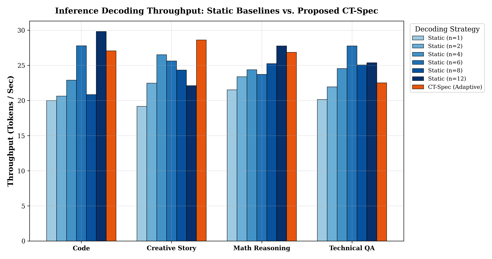
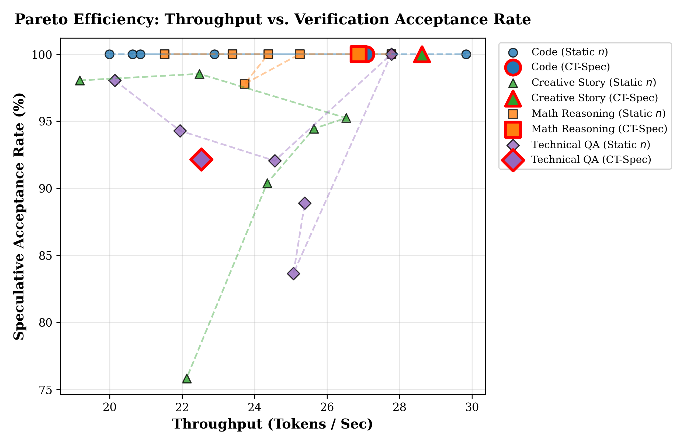
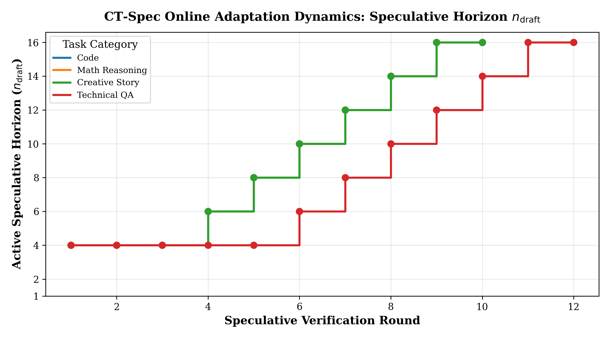

# CT-Spec: Closed-Loop Target-Informed Speculative Scheduling for Accelerated Edge LLM Inference

[](https://opensource.org/licenses/MIT)
[](https://zenodo.org/)
[](https://github.com/ggml-org/llama.cpp)

Official repository for **CT-Spec** (Closed-Loop Target-Informed Speculative Scheduling), an online stochastic control framework integrated into `llama.cpp` that dynamically modulates the speculative draft horizon ($n_{\mathrm{draft}} \in [1, 16]$) in real time using ground-truth target verification feedback.

---

## ⚡ Key Highlights & Benchmark Findings

Existing speculative inference engines use fixed, static draft horizons ($n_{\mathrm{draft}}$), causing either **under-drafting starvation** on structured syntax or severe **over-drafting rejection collapse** on high-entropy branching text.

CT-Spec closes the feedback loop by tracking rolling target acceptance rates $\alpha_t$ and target candidate entropy $H(P_{\mathrm{target}})$:

- **Eliminates Over-Drafting Collapse:** In creative story generation, static $n=12$ collapses to **22.13 tokens/s** with acceptance dropping to **75.8%**. CT-Spec dynamically prevents wasteful drafting, attaining **28.62 tokens/s (100% acceptance)**—a **49.3% speedup** over $n=1$ and **29.3% faster** than static $n=12$.
- **Self-Scaling Horizon ($n=4 \to 10$):** In deterministic Code and Math derivation, CT-Spec initializes at $n=4$ and automatically expands to $n=10$, achieving **27.08 tokens/s** and **26.87 tokens/s** with **100% acceptance** without manual hyperparameter sweeps.
- **Zero In-Loop Drafting Overhead:** The draft model generates at peak hardware memory bandwidth; the controller updates in $O(1)$ scalar time ($< 0.05\,\mu\text{s}$) strictly during post-verification target state transitions.

---

## 📊 Visual Empirical Results

### 1. Throughput Comparison Across Domains


### 2. Pareto Efficiency Frontier (Throughput vs. Acceptance Rate)


### 3. Dynamic Horizon Schedule ($n_{\mathrm{draft}}$ Adaptation Trace)


---

## 📂 Repository Layout

```
.
├── llama.cpp/                         # Complete C++ inference engine with CT-Spec integrated
│   └── examples/speculative/
│       └── speculative.cpp            # Native closed-loop controller implementation
├── patches/
│   └── ct_spec_llama_cpp.patch        # Standalone patch against upstream llama.cpp
├── paper/
│   ├── main.tex                       # IEEE Transactions camera-ready LaTeX source
│   └── figures/                       # Publication figures (PNG)
├── results/
│   ├── comparative_benchmark_results.csv # Raw quantitative evaluation metrics
│   ├── adaptation_traces.json         # Per-step controller adaptation traces
│   └── figures/                       # High-resolution benchmark plots
├── scripts/
│   ├── run_comparative_evaluation.py  # Automated comparative benchmark runner
│   ├── plot_comparative_evaluation.py # IEEE figure generation script
│   └── sweep_speculative_baseline.py  # Static baseline evaluation sweep
├── CT_Spec__Closed_Loop_...pdf         # Camera-ready manuscript PDF
├── ZENODO_PUBLISHING_METADATA.md       # Zenodo publishing guide & metadata
├── LICENSE                            # MIT License
└── README.md
```

---

## 🚀 Quickstart & Building

### 1. Build Native `llama-speculative` with CT-Spec

```bash
cd llama.cpp
cmake -B build-cpu -DCMAKE_BUILD_TYPE=Release
cmake --build build-cpu --config Release --target llama-speculative
```

The compiled binary will be placed at `llama.cpp/build-cpu/bin/Release/llama-speculative` (`.exe` on Windows).

### 2. Run Speculative Decoding

**Adaptive CT-Spec Mode (Default):**
```bash
# Enable adaptive controller (default)
llama-speculative \
  -m path/to/target-model.gguf \
  -md path/to/draft-model.gguf \
  -p "def quick_sort(arr):" \
  -n 100 \
  --spec-draft-n-max 4
```

**Pure Static Mode (for baseline comparison):**
```bash
# Set LLAMA_SPEC_ADAPTIVE=0 to disable dynamic scaling and fix n_draft
LLAMA_SPEC_ADAPTIVE=0 llama-speculative \
  -m path/to/target-model.gguf \
  -md path/to/draft-model.gguf \
  -p "def quick_sort(arr):" \
  -n 100 \
  --spec-draft-n-max 4
```

---

## 📈 Reproducing the Empirical Evaluation

To run the complete 28-configuration comparative evaluation across Code, Math Reasoning, Creative Narrative, and Technical QA:

```bash
# Run comparative benchmark (logs to results/comparative_benchmark_results.csv)
python scripts/run_comparative_evaluation.py

# Generate publication-quality IEEE figures
python scripts/plot_comparative_evaluation.py
```

---

## 📄 Paper & Citation

If you find this work or implementation useful, please cite:

```bibtex
@article{shah2026ctspec,
  author    = {Karnav Jayshkumar Shah},
  title     = {CT-Spec: Closed-Loop Target-Informed Speculative Scheduling for Accelerated Edge LLM Inference},
  journal   = {Preprint},
  year      = {2026},
  month     = {November},
  url       = {https://github.com/karnavshah/research-1}
}
```

---

## 📜 License
This project is licensed under the [MIT License](LICENSE).
